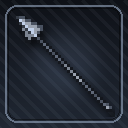

# 重矛（Heavy Spear）

> Minecraft **1.21.1** / **NeoForge** / 依赖 **VanillaBackport** 的长矛扩展  
> 一把同时吃“重锤附魔”和“长矛附魔”的下界合金重矛。




---

## 0. 先说结论

可以，而且已经做成一个独立模组：

- 新增武器 **重矛**（`heavyspear:heavy_spear`）。
- 保留 VanillaBackport 长矛的 **4.5 格攻击距离、蓄力突刺、`lunge`（突刺）附魔**。
- 同时接受重锤的 **密度（Density）、破甲（Breach）、风爆（Wind Burst）**，并保留重锤的 **落地猛击**、范围击退、落地伤害加成。
- 贴图是把原版长矛重绘成重锤的灰钢色；物品栏与手持都有模型。
- 合成：**重锤核心 + 下界合金长矛**，不消耗重锤本身。
- 只有数据包 + 一个 Java 物品类，没有 Mixin，不替换原版/其它模组的类。

> 本模组针对的是你整合包里 **VanillaBackport 1.2.x** 提供的长矛与 `minecraft:lunge` 附魔。  
> 如果你说的“长矛”其实是另一个模组的物品，兼容方式见 [§7](#7-如果长矛来自另一个-mod)。

---

## 1. 版本要求

| 项目 | 要求 |
| --- | --- |
| Minecraft | **1.21.1** |
| 加载器 | **NeoForge 21.1.x**（构建/测试基线 21.1.249；你整合包是 21.1.262，兼容） |
| Java | **21** |
| 前置模组 | **VanillaBackport 1.2.2 – 1.2.x**（提供 `minecraft:spears`、`netherite_spear`、`lunge`） |
| 前置模组的前置 | VanillaBackport 自己要求 **Platform 1.4+**；你的整合包已经包含 |
| 环境 | 客户端 + 服务端都可安装；纯服务端也能正常注册物品与附魔 |

---

## 2. 安装

1. 把 `heavyspear-1.21.1-1.0.0.jar` 放进 `mods/`。
2. 确认 `mods/` 里已经有 `VanillaBackport-neoforge-1.2.21.1-1.2.2.jar` 和 `Platform-neoforge-1.21.1-1.4.2.jar`。
3. 启动游戏。物品会出现在 **创造模式 → 战斗** 标签页，也可以直接 `/give @s heavyspear:heavy_spear`。
4. 首次进入世界后，JEI/REI 里能看到合成配方；拿到重锤核心时会解锁配方。

> 这是 NeoForge 模组，不是数据包；只放 `data/` 或 `assets/` 到存档的 `datapacks/` 里不会注册物品。

---

## 3. 合成

```
  H        H = 重锤核心（minecraft:heavy_core）
  S        S = 下界合金长矛（minecraft:netherite_spear）
```

- 工作台 3×3，竖着放：上格重锤核心，中格下界合金长矛。
- 只消耗 1 个重锤核心 + 1 把下界合金长矛，**不消耗重锤本身**。
- 设计上这是“给长矛加一个重锤核心配重”，所以比普通长矛贵，但不需要牺牲已经做好的重锤。

配方文件：`src/main/resources/data/heavyspear/recipe/heavy_spear.json`。  
想改成“重锤 + 长矛”合成，直接改这个 JSON 的 `key` / `result` 即可，不需要改 Java。

---

## 4. 属性

| 属性 | 数值 | 说明 |
| --- | --- | --- |
| 攻击伤害 | **8**（1 基础 + 7 武器） | 高于下界合金长矛；重锤为 6 |
| 攻击速度 | **0.74**（1 / 1.35 秒） | 比普通长矛慢，比重锤快 |
| 耐久 | **2031** | 下界合金级 |
| 附魔能力 | **15** | 与重锤相同，附魔不吃亏 |
| 攻击距离 | **4.5 格** | 继承 VanillaBackport 长矛的 `ATTACK_RANGE` 组件 |
| 防火 | 是 | 下界合金物品 |
| 修复材料 | 下界合金锭 / 风弹 | 两种都可以 |
| 稀有度 | RARE | 物品名淡蓝色 |

> 数值都在 `HeavySpearTier` 与 `HeavySpearItem` 的构造参数里，改起来很直观。  
> “攻击伤害 8”是主手面板值；实际伤害还会叠加附魔、蓄力突刺、落地猛击。

---

## 5. 附魔兼容

### 5.1 能上的附魔

| 附魔 | 来源 | 是否生效 |
| --- | --- | --- |
| 密度 Density | 重锤 | ✅ 落地猛击的每格坠落伤害 |
| 破甲 Breach | 重锤 | ✅ 降低目标护甲效果 |
| 风爆 Wind Burst | 重锤 | ✅ 落地攻击时触发风爆 |
| 火焰附加 Fire Aspect | 重锤 | ✅ 命中点燃 |
| 耐久 / 经验修补 | 通用 | ✅ |
| 突刺 Lunge | VanillaBackport 长矛 | ✅ 长矛蓄力突刺的后续效果 |
| 锋利 / 亡灵杀手 / 节肢杀手 | VanillaBackport 长矛（`#enchantable/sharp_weapon`） | ✅ |
| 消失诅咒 | 通用 | ✅（不想要可以附） |

### 5.2 不能同时存在

`密度`、`破甲`、`锋利`、`亡灵杀手`、`节肢杀手` 在 1.21.1 里共用 `#minecraft:exclusive_set/damage` 互斥组。  
所以“兼容”指的是**都可以附、都可以通过附魔台/铁砧/附魔书打上去**，不是“五个同时叠在一把武器上”。

### 5.3 兼容是怎么做的

- 把重矛加入 `#minecraft:spears`、`#minecraft:lunge_enchantable`、`#minecraft:enchantable/mace` 等物品标签；
- `Density` 不是纯数据效果：它需要 `MaceItem#getAttackDamageBonus` 里那段“按坠落距离计算伤害 + 查询 `smash_damage_per_fallen_block`”的逻辑，所以 `HeavySpearItem` 重写了 `getAttackDamageBonus`；
- `Wind Burst` / `Breach` 本身是通用附魔效果，只要物品在 `#enchantable/mace` 里就会正常触发；
- `Lunge` 依赖长矛的 `PiercingWeapon` 组件，重矛继承 `SpearItem`，构造时自动装上。

---

## 6. 代码结构

```
com.heavyspear
├── HeavySpear.java             模组入口、创造模式标签页
├── item
│   ├── HeavySpearItem.java     长矛行为 + 重锤猛击/密度伤害
│   └── HeavySpearTier.java     下界合金级材料，攻击伤害 +7
└── registry
    └── ModItems.java           注册 heavyspear:heavy_spear
```

关键点：

1. `HeavySpearItem extends SpearItem`，直接获得 VanillaBackport 的长矛蓄力、攻击距离、`lunge` 接口；
2. 复制/重写 `MaceItem` 的 `getAttackDamageBonus`、`hurtEnemy`、`postHurtEnemy` 与击退逻辑，使重矛在坠落攻击时和重锤一样；
3. 物品标签负责“哪些附魔能上”，Java 只负责“附魔效果真的生效”；
4. 没有 Mixin，不需要 `mixins.json`；不会和别的模组抢类。

---

## 7. 如果长矛来自另一个 Mod

当前实现绑定的是 **VanillaBackport**：

- 物品类继承 `com.blackgear.vanillabackport.common.level.items.spear.SpearItem`；
- 配方使用 `minecraft:netherite_spear`；
- 附魔标签使用 `minecraft:lunge_enchantable`。

如果你实际用的是另一个长矛 Mod（例如只有 `cnb:cactem_spear` 那种），需要改两处：

1. `build.gradle` 的 `compileOnly` 换成那个 Mod 的 jar；
2. `HeavySpearItem` 的父类换成那个 Mod 的长矛类（或改为自己实现长矛组件）；
3. 数据包标签改成那个 Mod 用来控制“长矛附魔”的 tag/`supported_items`。

如果你的整合包里其实有多把长矛、但只有 VanillaBackport 提供“长矛附魔”，那现在这版就是对的。

---

## 8. 从源码构建

### 方式 A：Gradle（推荐，需联网）

要求 JDK 21。VanillaBackport 的 jar 不随本仓库分发，先放到 `libs/`：

```text
libs/VanillaBackport-neoforge-1.2.21.1-1.2.2.jar
```

然后：

```bat
gradlew.bat build
```

产物：`build/libs/heavyspear-1.21.1-1.0.0.jar`。  
如果 jar 放在别处，也可以：

```bat
gradlew.bat build -PvanillabackportJar="D:\path\to\VanillaBackport-neoforge-1.2.21.1-1.2.2.jar"
```

### 方式 B：离线 javac（本机已验证）

```powershell
powershell -ExecutionPolicy Bypass -File tools\build-offline.ps1 -Version 1.0.0
```

`tools/classpath.txt` 是**本机**的编译类路径（NeoForge 21.1.249 + VanillaBackport）；换机器需要重新生成，详见 `tools/README.md`。  
这条路径不需要 Gradle 下载，但要求本机已有对应的 NeoForge 缓存。

### 方式 C：直接使用成品

`build/libs/heavyspear-1.21.1-1.0.0.jar` 就是已经编译好的模组，复制到 `mods/` 即可。

---

## 9. 文件清单

完整清单见 [FILES.md](FILES.md)，包括所有**未打包的源码、资源、数据包、构建脚本和成品 jar**。

> `libs/` 下的 VanillaBackport jar 只用于编译，**不随源码包分发**；它属于 VanillaBackport 作者，请从你的整合包/官方发布页获取。

---

## 10. 测试状态与注意事项

- 已用 JDK 21 对 NeoForge 21.1.249 + VanillaBackport 1.2.2 完整编译，jar 结构、TOML、JSON 均已检查。
- 未在本机启动 384 个 Mod 的完整客户端做游戏内实测；首次使用建议：
  1. 备份存档；
  2. 先在创造模式测试合成、附魔台、铁砧、落地猛击；
  3. 如果崩溃，把 `logs/latest.log` 发我，重点看 `heavyspear` 与 `vanillabackport` 相关行。
- 重矛的“落地猛击”只在**下落高度 > 1.5 格**时触发（与原版重锤一致），不是普通攻击每次都触发。
- 重矛的蓄力突刺与重锤猛击是两套攻击方式：普通左键是长矛/重锤混合攻击，右键蓄力是长矛突刺。

---

## 11. 许可

本模组代码与贴图：MIT（见 [LICENSE](LICENSE)）。  
VanillaBackport、Minecraft、NeoForge 的版权与许可归各自作者所有；本项目不包含它们的代码或资源。
